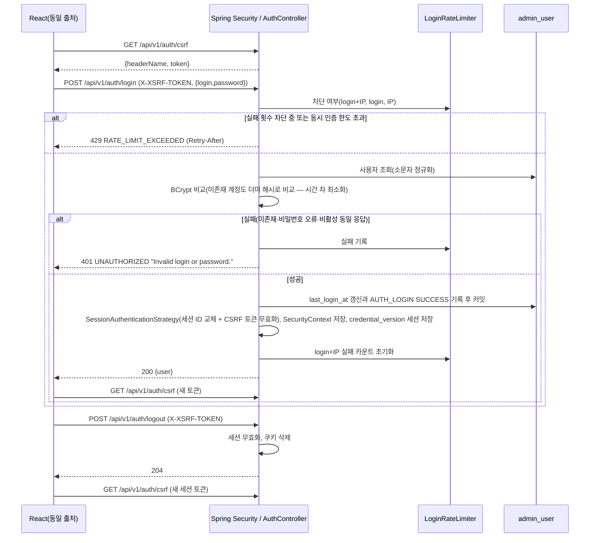

# T02 관리자 생성 CLI와 인증 흐름 (설계 검토용)
작성 2026-11-25(2차: ADR-044, 045, 051, 058, 060 반영) · 상태: 설계 기준선 · 근거: ADR-023, 024, 031, 036, 037, 044, 045, 051, 058, 060 · 의존성: spring-boot-starter-security(Boot 4.1.3 BOM → Spring Security 7.1.3), Caffeine(BOM 3.2.4)

## 1. 관리자 CLI (ADR-031)
### 실행
```
java -jar backend/build/libs/backend-<ver>.jar admin create --login <login>
java -jar backend/build/libs/backend-<ver>.jar admin reset-password --login <login>
```
- 같은 jar의 비웹 실행 모드: 첫 인자가 `admin`이면 `spring.main.web-application-type=none`으로 기동, `AdminCommandRunner`가 실행 후 종료 코드 반환(성공 0, 거부 2, 오류 1). 일반 서버 기동 경로와 분리.
- profile·DB 연결·허용 DB 검증(ADR-024)은 서버와 동일. 운영은 앱 계정으로 접속 — 필요한 권한은 admin_user SELECT/INSERT/UPDATE, admin_bootstrap SELECT/INSERT, audit_event INSERT뿐(ADR-058, `prod-app-grants.sql`).
- **비밀번호 입력**: `System.console().readPassword()` 2회(확인). 콘솔이 없으면(`System.console() == null`: Gradle `bootRun`, 파이프, IDE, Git Bash mintty) **실행 거부** — stdin 평문 입력으로 대체하지 않는다. Windows는 cmd/PowerShell 또는 `winpty` 사용 안내.
- 비밀번호는 명령 인자·환경변수·로그·audit에 절대 남기지 않는다. 읽은 `char[]`는 해시 후 `Arrays.fill`로 지운다.

### 비밀번호 규칙
| 규칙 | 값 | 위반 시 |
|---|---|---|
| 최소 길이 | 12자(코드 포인트 기준) | 거부, 사유 출력 |
| 최대 길이 | UTF-8 **72바이트 이하**(BCrypt 입력 한계) | 거부 — 잘라서 해시하지 않음 |
| 두 번 입력 일치 | 필수 | 거부 |
| 해시 | BCrypt, cost 12(`ai-studio.security.bcrypt-strength`, 허용 12~14) | — |
- 성능 검증: T02 단위 테스트에서 cost 12 해시 시간을 측정·기록(목표 0.1~1초, 로컬·CI). 결과로 기본값 재확인.
- Spring Security 7의 `BCryptPasswordEncoder`도 72바이트 초과를 예외로 처리하지만, 앱이 먼저 검사해 명확한 메시지를 준다.

### 최초 생성 (동시 실행 안전)
한 트랜잭션: ① `SELECT COUNT(*) FROM admin_user` > 0 또는 admin_bootstrap 행이 있으면 거부 ② admin_user INSERT ③ `admin_bootstrap(id=1)` INSERT — 두 CLI가 동시에 실행되면 두 번째는 PK 중복(1062)으로 실패 → 롤백, "이미 생성됨"으로 거부 ④ audit(actor_type=CLI, AUTH_ADMIN_CREATE) ⑤ COMMIT. 웹 가입 API 없음.

### 비밀번호 재설정
대상 login 존재 확인 → 새 비밀번호 규칙 검사 → hash·`password_changed_at` 갱신, **`credential_version` 1 증가**, version 증가 → audit. 실행 중인 서버의 기존 세션은 요청마다 세션에 저장된 credential_version과 DB 값을 비교해 무효화한다(ADR-060, 시각 비교 단독 사용 금지). 서버 재기동 없이 로그아웃된다.

## 2. 보안 필터 구성 (ADR-037)
| 경로 | 접근 |
|---|---|
| `/actuator/health` | 비인증 |
| `GET /api/v1/auth/csrf` | 비인증(토큰 발급) |
| `POST /api/v1/auth/login` | 비인증, **CSRF 검증 유지** |
| 로그인 화면·정적 파일(`/`, `/index.html`, `/assets/**`, SPA 라우트) | 비인증(운영 정적 제공 시) |
| 그 외 `/api/**` | 인증 + ROLE_ADMIN |
- CSRF: `HttpSessionCsrfTokenRepository`(토큰을 JS 읽기용 쿠키에 두지 않음), 헤더 `X-XSRF-TOKEN`. SPA는 `GET /auth/csrf`로 토큰을 받는다. **로그인 성공·로그아웃 후 토큰이 바뀌므로 SPA가 다시 조회**한다.
- 세션(ADR-044): 쿠키 `AI_STUDIO_SESSION`, HttpOnly, SameSite=Lax, Path=/, Secure(local/docker=false, prod=true), 유휴 만료 30분(`server.servlet.session.timeout=30m`). 세션 저장은 서블릿 컨테이너 메모리(단일 인스턴스, 재기동 시 로그아웃).
- 401/403: `AuthenticationEntryPoint`/`AccessDeniedHandler`가 공통 오류 형식(UNAUTHORIZED/FORBIDDEN, details 빈 배열, X-Trace-Id) 출력. CSRF 실패도 403 FORBIDDEN.
- 폼 로그인·HTTP Basic 비활성. 로그인은 JSON 컨트롤러가 `AuthenticationManager`를 호출.

## 3. 로그인·로그아웃 흐름

- 계정 존재 비노출: 미존재·비밀번호 오류·비활성 계정 모두 같은 401 코드·메시지, 비슷한 처리 시간. rate limit은 계정 존재와 무관하게 적용.
- 세션 검증 필터(ADR-060): 인증된 요청마다 admin_user를 조회해 `enabled=false` 또는 `credential_version ≠ 세션의 credential_version`이면 세션 무효화 후 401.
- JSON 로그인은 `AuthenticationManager` 인증 후 `CompositeSessionAuthenticationStrategy`(ChangeSessionIdAuthenticationStrategy + CsrfAuthenticationStrategy)를 직접 호출하고 `HttpSessionSecurityContextRepository`에 저장한다. 테스트로 세션 ID 변경, 이전 CSRF 토큰 거부, 저장된 컨텍스트로 다음 요청 인증을 확인한다.
- `AUTH_LOGIN`의 SUCCESS와 `last_login_at`은 관리자의 자격 증명 확인 및 필수 DB 기록 커밋을 의미한다. 세션 발급은 이후 별도 단계다. 세션 저장 실패 시 인증 컨텍스트와 세션을 폐기하고 오류를 반환하며, 이미 커밋된 감사 및 시각은 보존한다.
- audit(ADR-051): AUTH_LOGIN(SUCCESS/FAILURE, 정규화 login·IP, 비밀번호·토큰·세션 ID 제외), AUTH_LOGOUT, AUTH_RATE_LIMITED(차단 키·창마다 1건만 — 차단 중 반복 시도는 기록하지 않음), 관리자 CLI 작업. 보존 기본 90일(정책), 삭제는 별도 관리 절차.

## 4. 로그인 제한 (ADR-036)
| 키 | 한도 | 창 | 도달 시 |
|---|---|---|---|
| login(정규화)+IP | 실패 5회 | 15분 | 15분 차단, 429 |
| login | 실패 10회 | 15분 | 15분 차단, 429 |
| IP | 실패 30회 | 15분 | 15분 차단, 429 |
- 구현: Caffeine 캐시 3개(`expireAfterWrite` 15분+차단 15분, `maximumSize` 각 10,000 — 설정 가능). 고정 창 카운터 + 차단 만료 시각. 최대 크기 초과 시 Caffeine이 오래된 항목 제거(메모리 상한), 제거 시 WARN 로그.
- 동시 인증은 요청의 정규화 login당 1건, IP당 2건, 인스턴스 전체 4건까지 허용한다. 인증 및 더미 BCrypt 이전에 적용하며 대기 없이 기존 429와 `Retry-After: 1`을 반환한다. 과부하 응답은 실패 횟수에 더하지 않는다. 기존 실패 차단을 독립적으로 확인하고 요청 종료 시 동시 인증 상태를 제거한다.
- 성공 로그인은 해당 login+IP 카운터만 초기화(login·IP 전체 카운터는 유지 — 분산 공격 대비).
- IP = `request.getRemoteAddr()`만(ADR-045). `X-Forwarded-For` 등은 사용하지 않음, `server.forward-headers-strategy=none` 명시. Docker 개발 포트는 127.0.0.1에만 노출.
- 알려진 한계: 재기동 시 초기화, 다중 인스턴스 미지원, 운영에서 리버스 프록시 뒤면 모든 요청 IP가 같아 IP 한도가 전체 한도가 됨(신뢰 프록시는 운영 배포 단계, ADR-045).

## 5. 테스트 (T02 구현 시)
- CLI: 콘솔 없음 거부, 12자 미만·72바이트 초과(멀티바이트 포함) 거부, 동시 최초 생성 2건 → 1건만 성공(IT), 재설정 후 기존 세션 401.
- 인증: 세션 ID 교체 확인, 로그아웃 후 세션 무효, 30분 유휴 만료(시간 조작), CSRF 없는 로그인·변경 요청 403, 401/403 공통 형식, 미존재/오류 응답 동일성.
- rate limit: 키별 한도·차단·만료, 최대 크기 제거, 전달 헤더 무시.
- 쿠키: profile별 Secure/HttpOnly/SameSite 헤더 검사.

## 후속 단계 필수 제약 (T02 통합 승인, 2026-11-25)
운영 배포 전 신뢰 프록시·실제 클라이언트 IP 처리(로그인 실패 제한·동시 인증 상한은 현재 `remoteAddr` 기준, P-T02-04 CR-01)와 다중 인스턴스 시 분산 로그인 제한·시계 동기화를 설계한다. [T03_PLAN](../plans/T03_PLAN.md) 7·9번.
