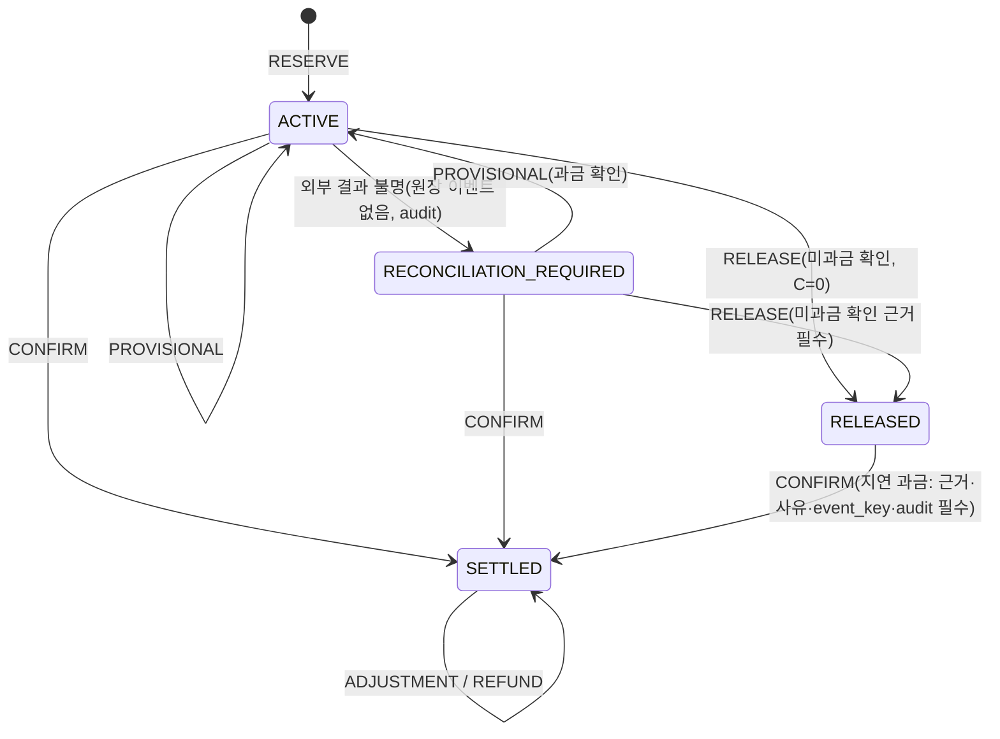

# T02 예산 예약·정산·원장 설계 (설계 기준선)
작성 2026-11-25(2차: ADR-039~061 반영) · 근거: ADR-017, 019, 026~030, 038, 042, 043, 046, 048, 049, 054~057, 061 · 테이블: [T02_DATA_MODEL.md](T02_DATA_MODEL.md)

## 1. 표기
| 기호 | 의미 | 저장 위치 |
|---|---|---|
| E | 예약 KRW `estimate_krw` | budget_reservation |
| RR | 남은 예약 `reserved_remaining_krw` | budget_reservation |
| C | 인식 비용 KRW `recognized_cost_krw` | budget_reservation |
| C₀ | 인식 비용 원본 통화 `recognized_cost_original` | budget_reservation |
| r | 예약 시점 고정 환율 `fx_rate`(KRW 예약은 1) | budget_reservation, cost_log |
| ceil6 / round6 | 소수 6자리 CEILING / HALF_UP(부호 대칭) | — |
| K(x₀) | `round6(x₀ × r)` — 원본 금액을 한 번만 KRW로 환산 | — |

## 2. 계산식 (ADR-030, ADR-056, ADR-057)
모든 이벤트는 `reserve_delta_krw`(ΔR), `cost_delta_krw`(ΔC), `cost_delta_original`(ΔC₀)을 기록하고 예약과 연결된 **모든 bucket**에 같은 값을 적용한다:
`bucket.reserved += ΔR`, `bucket.spent += ΔC`, `RR += ΔR`, `C += ΔC`, `C₀ += ΔC₀`.

| 이벤트 | 입력 | ΔC | ΔR | ΔC₀ | 원장 amount(원본 / KRW) | 상태 |
|---|---|---|---|---|---|---|
| RESERVE | 예상 원본 금액 e₀ | 0 | `+E`, `E = ceil6(e₀×r)` | 0 | e₀ / E | (없음)→ACTIVE |
| PROVISIONAL | 잠정 **총액** P₀ (예약 통화) | `newCost − C`, `newCost = K(P₀)` | `newReserved − RR`, `newReserved = max(0, E − newCost)` (**양수 가능**) | `P₀ − C₀` | ΔC₀ / ΔC | ACTIVE·RECONCILIATION_REQUIRED→ACTIVE |
| CONFIRM | 확정 **총액** F₀ (예약 통화) | `K(F₀) − C` (PROVISIONAL 없으면 C=0) | `−RR` | `F₀ − C₀` | ΔC₀ / ΔC | ACTIVE·RECONCILIATION_REQUIRED→SETTLED, RELEASED→SETTLED(지연 과금) |
| RELEASE | — (C=0) | 0 | `−RR` | 0 | 0 / 0 | ACTIVE·RECONCILIATION_REQUIRED→RELEASED |
| ADJUSTMENT(원본 통화) | 예약 통화 증감 a₀ | `round6(a₀×r)` | 0 | a₀ | a₀ / ΔC | SETTLED |
| ADJUSTMENT(KRW 전용, 예: FX_DIFFERENCE) | KRW 증감 a (예약 통화 ≠ KRW) | a | 0 | **0** | a / a (KRW, r=1) | SETTLED |
| REFUND(원본 통화) | 예약 통화 환불 f₀ > 0 | `−round6(f₀×r)` | 0 | −f₀ | −f₀ / ΔC | SETTLED |
| REFUND(KRW 전용) | KRW 환불 f > 0 | −f | 0 | **0** | −f / −f | SETTLED |
- 예약 통화가 KRW이면 원본 통화와 KRW 전용 구분이 없고(r=1) ΔC₀ = ΔC.
- 불변식: `C ≥ 0`, `C₀ ≥ 0`, `RR ≥ 0`. 위반하는 조정·환불은 POLICY_VIOLATION(422).
- 잠정 비용이 줄면 E 안의 미사용분이 다시 예약으로 돌아간다(ΔR > 0). 확정 전 예산이 과도하게 풀리지 않는다(ADR-056). 다시 예약되는 금액은 이미 검사를 통과한 E 범위 안이므로 한도 재검사를 하지 않는다.
- 예상 초과: newCost > E이면 newReserved = 0, 초과분은 spent에 그대로 더한다(반드시 기록). bucket이 한도를 넘을 수 있으며 이후 신규 예약은 검사식으로 차단. WARN 로그 + audit `BUDGET_OVERRUN`.
- 실제 결제 환율 차이(ADR-027): KRW 전용 ADJUSTMENT `reason_code=FX_DIFFERENCE`. 예약 환율과 C₀는 바꾸지 않는다.
- 같은 예약의 정산은 예약 시 연결된 bucket에 반영(기간 종료 후 지연 정산 포함, ADR-038).
- 예산 검사: 각 연결 bucket b에 대해 `b.spent + b.reserved + E ≤ b.limit`. 위반 시 BUDGET_EXCEEDED(422), 아무것도 기록하지 않음. 한도 0원은 어떤 예약도 허용하지 않는다(무제한 아님, ADR-054).

### 계산 예시 (USD, r = 1400.1234567891, E = ceil6(1.00×r) = 1400.123457)
| 단계 | 입력 | ΔC | ΔR | 결과 |
|---|---|---|---|---|
| RESERVE | e₀=1.00 | 0 | +1400.123457 | RR=1400.123457 |
| PROVISIONAL | P₀=0.80 | +1120.098765 | −1120.098765 | C=1120.098765, RR=280.024692 |
| PROVISIONAL(감소) | P₀=0.30 | −700.061728 | +700.061728 | newCost=round6(420.03703703673)=420.037037, RR=980.086420 |
| PROVISIONAL(증가) | P₀=0.90 | +840.074074 | −840.074074 | newCost=1260.111111, RR=140.012346 |
| CONFIRM | F₀=1.20 | +420.037037 | −140.012346 | C=1680.148148, RR=0, 초과 280.024691 기록 |
| ADJUSTMENT(KRW, FX_DIFFERENCE) | a=−50 | −50 | 0 | C=1630.148148, C₀=1.20 유지 |
| REFUND(USD) | f₀=0.10 | −140.012346 | 0 | C=1490.135802, C₀=1.10 |

## 3. 예약 상태 전이 (ADR-028, ADR-048)

| 상태 \ 이벤트 | RESERVE | PROVISIONAL | CONFIRM | RELEASE | ADJUSTMENT | REFUND | 불명 표시 |
|---|---|---|---|---|---|---|---|
| (없음) | 생성 | ✗ | ✗ | ✗ | ✗ | ✗ | ✗ |
| ACTIVE | 멱등 재요청만 | ✓ | ✓ | ✓(C=0) | ✗ | ✗ | ✓ |
| RECONCILIATION_REQUIRED | 멱등 재요청만 | ✓ | ✓ | ✓(근거 필수) | ✗ | ✗ | — |
| SETTLED | 멱등 재요청만 | ✗ | ✗ | ✗ | ✓ | ✓ | ✗ |
| RELEASED | 멱등 재요청만 | ✗ | ✓ 지연 과금(`reason_code=LATE_CHARGE`, external_ref·note 필수, ΔR=0) | ✗ | ✗ | ✗ | ✗ |
✗ = INVALID_STATE_TRANSITION(409). C>0인 RELEASE 거부. 과금 불명 상태는 **자동 해제하지 않는다**(외부 조회 T04 또는 관리자 확정만). 기존 이벤트는 수정하지 않는다.

## 4. 신규 예약 허용 조건 — Fail Closed (ADR-042, 054, 061)
예약 트랜잭션 안에서 잠금 후 순서대로 검사, 하나라도 실패하면 아무것도 기록하지 않는다.
| 조건 | 실패 코드 |
|---|---|
| `budget_control.spending_enabled = true` (기본 false, 관리자 긴급 차단) | POLICY_VIOLATION |
| `budget_control.consistency_status ≠ ERROR` | PREREQUISITE_NOT_MET |
| SYSTEM DAY와 SYSTEM MONTH 정책이 모두 존재하고 ACTIVE | PREREQUISITE_NOT_MET |
| 채널 지정 시 채널 ACTIVE(PAUSED·ARCHIVED 차단) | PREREQUISITE_NOT_MET |
| 외화면 유효 환율 존재(최신 발효 환율이 만료면 이전 환율 사용 금지) | PREREQUISITE_NOT_MET |
| 모든 적용 bucket 검사식 통과(활성 CHANNEL 정책은 추가 적용) | BUDGET_EXCEEDED |
지출 차단 중에도 기존 예약의 정산·조회·관리자 확정은 허용(ADR-061). 실제 provider 호출은 T07 승인 전 없음 — T02의 예약 서비스는 내부 API와 테스트에서만 호출된다.

## 5. 멱등성 (ADR-026, ADR-053)
- 예약: `request_key`(utf8mb4_bin, 대소문자 구분) UNIQUE + `request_fingerprint` = SHA-256(정규화 JSON `{channelId, contentId, purpose, currency, estimateOriginal}`, 금액 `stripTrailingZeros().toPlainString()`, 키 순서 고정).
- 이벤트: `event_key`(utf8mb4_bin) UNIQUE + `event_fingerprint` = SHA-256(`{reservationId, entryType, currency, amountOriginal, reasonCode, externalRef}`). 관리자 API는 `Idempotency-Key` 헤더가 event_key.
- 같은 key + 같은 fingerprint → 기존 결과 반환(추가 기록 없음). 같은 key + 다른 fingerprint → 409 RESOURCE_CONFLICT.
- 경쟁: 잠금 전에 key 조회 → 없으면 진행 → INSERT 1062면 롤백 후 재조회해 위 규칙 적용.

## 6. 트랜잭션·잠금 (ADR-043, ADR-055)
**전역 잠금 순서: budget_control → channel → budget_policy(id↑) → budget_bucket(id↑) → budget_reservation(id↑) → 이벤트 INSERT.** 필요한 행만 잠그고 역순으로 잠그지 않는다. 격리 수준 READ COMMITTED. 공유 잠금은 `LOCK IN SHARE MODE`.
| 트랜잭션 | 잠금 |
|---|---|
| 예약 | control S → channel S(지정 시) → 적용 정책 X → (bucket 없으면 정책 잠금 하에 INSERT) → bucket X → 검사 → reservation·link·RESERVE INSERT, bucket 갱신 |
| 정산 이벤트·관리자 확정·조정·불명 표시 | control S → 연결 bucket X(불명 표시는 생략) → reservation X → 상태·멱등 검사 → cost_log INSERT, 갱신 |
| 정책 생성 | control X → channel S(CHANNEL scope, ARCHIVED면 INVALID_STATE_TRANSITION) → policy·revision INSERT |
| 정책 revision·enable·disable | control X → policy X(version·baseRevisionNo 검사) → 열린 bucket X(한도 갱신) → INSERT/UPDATE |
| 채널 일시정지·재개·보관 | control S → channel X(version 검사, 진행 중 예약 트랜잭션과 직렬화) |
| 지출 허용/차단 | control X |
| 정합성 검사 | control X(검사 중 예약·정산 정지) → 결과를 control에 기록 |
| 채널 설정 revision(ADR-059) | channel X → baseRevisionNo = 현재 최대 확인 → INSERT(UNIQUE 충돌도 409) |
- 데드락(1213)·잠금 대기 초과(1205)는 전체 롤백 후 최초 실행 외 최대 3회 재시도, 지수 백오프(50ms·100ms·200ms) + 0~50% jitter. 비즈니스 오류는 재시도하지 않는다.
- 잠금 재시도 경계는 최상위 트랜잭션을 시작한다. 호출 스레드에 상위 트랜잭션이 활성화된 경우 재시도 작업이나 SQL 변경 전에 호출 계약 위반으로 실패한다. 향후 T03 작업 상태 전이와 예산 호출의 원자성 및 트랜잭션 경계는 별도로 설계한다.
- 외부 API 호출은 트랜잭션 밖에서만 한다.

## 7. 기간과 시간대 (ADR-017, ADR-038, ADR-049)
- `natural(Z, type, t)`: DAY = Z 기준 날짜의 `atStartOfDay(Z)`~다음 날, MONTH = 1일 0시~다음 달 1일 0시. DST 날은 23/25시간.
- **시간대 효력 시각**: revision의 `timezone_effective_from`. 시간대를 바꾸는 revision은 변경 시각 t_c가 속한 **기존 규칙의 기간 끝**을 효력 시각으로 저장한다(bucket 존재 여부와 무관). 한도만 바꾸는 revision은 직전 값을 그대로 복사. 같은 효력 시각에 여러 revision이면 마지막 revision의 시간대.
- 시각 t의 기간: 효력 시각 ≤ t인 마지막 구간 i(시간대 Zᵢ, 시작 Sᵢ)를 찾는다. i=첫 구간이면 natural(Z₀, t). 그 외 **전환 기간** `[Sᵢ, X)`: B = natural(Zᵢ, Sᵢ); B.start = Sᵢ면 X = B.end, 아니면 X = natural(Zᵢ, B.end).end(자투리 + 완전한 1기간). t < X면 전환 기간, 아니면 natural(Zᵢ, t).
- 다음 구간 시작 Sᵢ₊₁은 구간 i 규칙의 기간 경계이므로 기간이 겹치거나 비지 않는다. 한도는 1기간분이므로 자투리로 예산이 초기화되지 않는다.
- 예: DAY, Asia/Seoul → America/New_York(UTC−5)를 2026-11-26 01:00Z(서울 10:00)에 변경 → 효력 2026-11-26 15:00Z(서울 자정). 전환 기간 [11-26 15:00Z, 11-28 05:00Z) = NY 11-26 10시~11-28 0시. 그 사이 bucket이 없어도 같은 결과.
- 한도 변경은 즉시: 열린 bucket(period_end > now)의 limit_krw·limit_policy_revision_no를 새 revision으로 갱신. 비활성화는 신규 예약에서만 제외(SYSTEM 정책 비활성 시 전체 차단, §4). 기간 유형 변경 불가.

## 8. 환율 (ADR-027, ADR-046)
- 등록: base(KRW 제외 ISO 4217 대문자), rate(소수 ≤10, >0), effectiveFrom(기본 now, 허용 범위 now−5분 ~ now+7일), validUntil = effectiveFrom + `ai-studio.budget.exchange-rate-validity`(기본 PT72H). 불변.
- 조회: `effective_from ≤ now`인 **가장 최근** 1건. 그 건의 `valid_until ≤ now`면 유효 환율 없음(이전 환율로 fallback 금지) → PREREQUISITE_NOT_MET. 기존 예약 정산은 예약 시 고정 환율 사용.

## 9. 정합성 검사 (ADR-026, ADR-054)
`POST /api/v1/budget/consistency-checks`가 아래를 검사하고 결과(OK/ERROR, 건수, 시각)를 budget_control에 기록한다. ERROR면 신규 예약 차단, 다음 OK 검사 후 해제. 자동 수정 없음.
| 코드 | 검사 |
|---|---|
| RESERVATION_BUCKET_LINK_MISMATCH | 예약 시각을 포함하는 SYSTEM DAY와 MONTH를 각각 하나씩 연결했는지 확인한다. CHANNEL 연결은 해당 채널의 DAY·MONTH 각각 최대 하나이며 연결된 정책은 예약 당시 존재해야 한다. 저장된 기간과 정책의 범위·기간 유형을 사용하므로 이후 상태·revision·시간대 변경과 독립적이다. |
| RESERVATION_RESERVED_MISMATCH | RR = Σ ΔR |
| RESERVATION_COST_MISMATCH | C = Σ ΔC |
| RESERVATION_ORIGINAL_COST_MISMATCH | C₀ = Σ ΔC₀ |
| BUCKET_RESERVED_MISMATCH / BUCKET_SPENT_MISMATCH | bucket = Σ(연결 예약 이벤트의 ΔR / ΔC) |
| BUCKET_OVERLAP | 같은 정책·대상 bucket 기간 겹침 |
| BUCKET_REVISION_MISMATCH | bucket.limit_krw = 해당 limit_policy_revision_no의 limit, 열린 bucket은 현재 revision |
| CLOSED_RESERVATION_HAS_RESERVE / MISSING_RESERVE_EVENT | 종료 예약 RR=0, 모든 예약에 RESERVE 1건 |

## 10. 후속 단계 필수 제약 (T02 통합 승인, 2026-11-25)
T03 이후 콘텐츠 예산 연결 시 링크 정합성 검사(`RESERVATION_BUCKET_LINK_MISMATCH`) 확장, 재시도 경계의 상위 트랜잭션 금지, 작업 큐와 예산의 멱등 키 기반 일관성, `reserve:`·`reserve-v2:` 접두사 예약, 판정 재계획 503 재시도, 정합성 검사 스캔·잠금 시간, 비용 발생 전 정합성 오류 복구 절차는 [T03_PLAN](../plans/T03_PLAN.md)의 선행 조건을 따른다.
