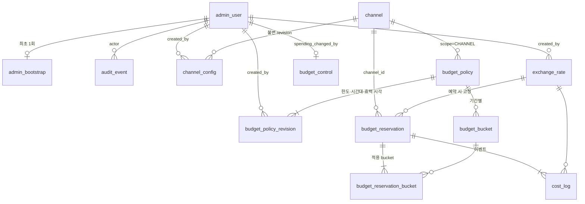

# T02 데이터 모델 (설계 기준선)
작성 2026-11-25(2차: ADR-039~061 반영) · DDL: [T02_DDL_DRAFT.sql](T02_DDL_DRAFT.sql)(구현 후에는 migration V3~V5가 기준) · 계산·잠금: [T02_BUDGET_LEDGER.md](T02_BUDGET_LEDGER.md)

## 1. ERD

`budget_control`은 단일 행(id=1) 전역 제어(지출 허용, 정합성 상태)이며 잠금 순서의 첫 자원이다(ADR-055).

## 2. 공통 규칙
- PK `BIGINT AUTO_INCREMENT`, API에서는 문자열(ADR-032). 시각 `DATETIME(6)` UTC, 앱이 `Clock`으로 지정.
- collation: 테이블·컬럼 기본 `utf8mb4_unicode_ci`. **의도적 예외(ADR-053)** — 정확 비교 컬럼 `utf8mb4_bin`: `admin_user.password_hash`, `budget_reservation.request_key`, `budget_reservation.request_fingerprint`, `cost_log.event_key`, `cost_log.event_fingerprint`, `cost_log.request_key`. JSON 컬럼(`audit_event.details_json`, `channel_config.provider_options_json`)은 MariaDB가 utf8mb4_bin 자동 적용. `MigrationConventionTest`가 이 목록 외 collation 지정을 거부한다.
- `admin_user.login`은 소문자 정규화 + unicode_ci UNIQUE(대소문자만 다른 중복 금지, 의도).
- REGEXP CHECK는 unicode_ci에서 대소문자 무시 → 구분 필요 시 `(?-i)`.
- DECIMAL 초과 자릿수는 무경고 반올림 → 앱이 scale 검증·지정.
- 불변 테이블(UPDATE/DELETE 트리거 차단): admin_bootstrap, audit_event, channel_config, exchange_rate, budget_policy_revision, budget_reservation_bucket, cost_log. budget_control은 DELETE 차단. 운영은 권한으로도 차단(§5).

## 3. 테이블 요약
| 테이블 | 핵심 컬럼 | UNIQUE | 주요 CHECK | 인덱스 | Migration |
|---|---|---|---|---|---|
| admin_user | login, password_hash(bin), credential_version, role, enabled, password_changed_at, last_login_at, version | login | login 형식, BCrypt 접두사, credential_version≥1, role=ADMIN | uk | V3 |
| admin_bootstrap | id=1, admin_user_id | PK | id=1 | — | V3 |
| audit_event | occurred_at, actor_type/user, action, outcome, entity, trace_id, client_ip, details_json | — | 열거값 | entity, occurred, actor | V3 |
| channel | name, language, timezone, status, version, archived_at | name | 상태 열거, ARCHIVED⇔archived_at | (status,id) | V4 |
| channel_config | channel_id, revision_no, default_content_type, shorts/longform 초 범위, content_strategy, target_audience, narration_style, visual_style, synthetic_disclosure_default, provider_options_json, change_note, created_by | (channel_id, revision_no) | 길이 범위 | uk | V4 |
| budget_control | spending_enabled(기본 false), spending_changed_*, consistency_status(UNKNOWN/OK/ERROR), consistency_checked_at, consistency_issue_count, version | PK(id=1) | 단일 행 | — | V5(초기 행 포함) |
| exchange_rate | base, quote=KRW, rate(24,10), effective_from, valid_until, source=MANUAL | (base,quote,effective_from) | base≠KRW, rate>0 | uk | V5 |
| budget_policy | scope, channel_id, content_type, content_id(T03), period_type, status, current_revision_no, version, scope_key(생성) | (scope_key, period_type) | scope별 조합, T02 content_id NULL | (scope,channel_id,status) | V5 |
| budget_policy_revision | policy_id, revision_no, limit_krw(24,6), timezone, timezone_effective_from, change_note, created_by | (policy_id, revision_no) | limit≥0 | uk | V5 |
| budget_bucket | policy_id, content_id(T03), subject_key, period_start/end, timezone, limit_krw, limit_policy_revision_no, reserved_krw, spent_krw, version | (policy_id, subject_key, period_start) | end>start, 금액≥0 | (policy_id, subject_key, period_end) | V5 |
| budget_reservation | request_key(bin), request_fingerprint(bin), channel_id, content_id(T03), purpose, original_currency, estimate_original(24,12), exchange_rate_id, fx_rate(24,10), estimate_krw, status, reserved_remaining_krw, recognized_cost_krw, recognized_cost_original, reconciliation_reason, version, closed_at | request_key | KRW⇔rate 1, 종료⇔closed_at, 종료 RR=0, RELEASED C=0, 금액≥0 | (status,created_at), (channel_id,created_at) | V5 |
| budget_reservation_bucket | reservation_id, bucket_id | PK | — | (bucket_id) | V5 |
| cost_log | event_key(bin), event_fingerprint(bin), reservation_id, request_key(bin), entry_type, reason_code, original_currency, original_amount, fx_rate, exchange_rate_id, amount_krw, reserve_delta_krw, cost_delta_krw, cost_delta_original, price_version, external_ref, actor, trace_id, occurred_at, recorded_at | event_key | 유형별 delta 부호(PROVISIONAL은 ΔR 부호 자유, ADR-056), KRW 이벤트 r=1 | (reservation_id,id), (request_key), (entry_type,recorded_at), (recorded_at) | V5 |

설계 판단:
- 채널 현재 설정은 `MAX(revision_no)` 조회(순환 FK 회피). 설정 revision 번호와 channel.version은 별개(ADR-034). 생성은 channel 행 잠금 + baseRevisionNo 검증(ADR-059).
- 콘텐츠 유형 기본 한도(ADR-029): scope=CONTENT_TYPE, LIFETIME, channel_id NULL(시스템) 또는 지정(채널). T02는 설정만, 예약 적용은 T03.
- T03 확장: `ck_*_no_content` CHECK DROP + content FK·CONTENT scope 조합을 신규 migration으로.
- 감사 보존(ADR-051): 기본 90일 보존 **정책**만 정의. 트리거가 DELETE를 막으므로 실제 삭제는 별도 승인된 관리 절차(예: 트리거를 다루는 migration 계정 작업)로 분리. 로그인 실패는 rate limit 차단 중에는 키·차단 창마다 1건만 기록(폭증 방지).

## 4. 정합성 검사
검사 항목과 처리: [T02_BUDGET_LEDGER.md §9](T02_BUDGET_LEDGER.md). 결과는 `budget_control.consistency_*`에 기록되고 ERROR면 신규 예약을 막는다(ADR-054).

## 5. DB 권한 (ADR-025, 026, 050, 058)
| 계정 | 권한 |
|---|---|
| 운영 앱 | [infra/mariadb/prod-app-grants.sql](../../infra/mariadb/prod-app-grants.sql): admin_user·channel·budget_policy·budget_bucket·budget_reservation SELECT/INSERT/UPDATE, budget_control SELECT/UPDATE, admin_bootstrap·audit_event·channel_config·exchange_rate·budget_policy_revision·budget_reservation_bucket·**cost_log SELECT/INSERT**, flyway_schema_history SELECT. DELETE·DDL·SUPER 없음 |
| 운영 migration | ai_studio.* DDL+DML+TRIGGER. binlog ON 환경의 트리거 생성은 배포 전 검증 필수(ADR-050) |
| 로컬 | ALL PRIVILEGES ON ai_studio.*(ADR-025). 트리거가 불변성 보장 |
통합 테스트 `ProductionGrantsIT`가 이 템플릿을 그대로 적용한 계정으로 최초 관리자 생성(CLI 경로) 성공, 원장 UPDATE/DELETE·DDL·bootstrap 수정 거부를 검증한다.
